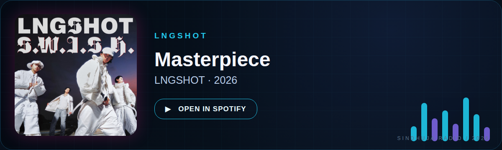

<div align="center">


<br />

# Hey, I’m **Sindhuja Marubothula** ✦

### `CSE student` · `aspiring AI engineer` · `creative builder`

<p>
  <a href="https://github.com/saisindhuja-code"></a>
  <a href="https://www.linkedin.com/in/marubothula-sai-sindhuja-8b9b0142b"></a>
  <a href="mailto:saisindhuja.marubothula@gmail.com"></a>
</p>

📍 **Hyderabad, Telangana, India**

</div>

---

## `01 / about me`

```yaml
name: Sindhuja Marubothula
location: Hyderabad, Telangana, India
role: CSE Student at KMIT |DSA Student at IITM| Aspiring AI Engineer
currently_learning: Python, C++, Machine Learning, Web Development
currently_building: AI-powered applications, creative coding projects, and interactive desktop tools
```

I’m a Computer Science Engineering student at **KMIT** with a growing interest in AI engineering and software development. I enjoy learning by building, experimenting with new technologies, and turning ideas into useful, creative applications.

I love turning creative ideas into actual software—especially when I can combine AI with something fun and interactive.

---

## `02 / current signal`

<table>
<tr>
<td width="50%">

### ✧ Exploring

- Software development
- AI and machine learning
- Computer vision
- Creative coding

</td>
<td width="50%">

### ✧ Open to

- Open-source contributions
- Collaborations on interesting projects
- AI/ML internships
- Software development internships

</td>
</tr>
</table>

---

## `03 / selected work`

### ✿ Bloom

A creative coding project that transforms personalized ideas into beautiful floral art. Initially built with Python Turtle, with plans to expand into an interactive web experience.

**Stack:** `Python` `Turtle` `HTML` `CSS` `JavaScript` `OpenCV` `MediaPipe`

<a href="https://project-bloom-delta.vercel.app/" target="_blank" rel="noopener noreferrer">
  Explore Bloom ↗
</a>

### ✦ Aster

A Windows AI companion with a witty, anime-inspired personality. Built to make AI interactions more engaging through a custom desktop interface.

**Stack:** `Python` `Groq API` `Qwen` `Windows`


---

## `04 / tools I use`

<p>
  
</p>

### Programming

`Python` · `C` · `C++`

### Web development

`HTML` · `CSS` · `JavaScript`

### AI, machine learning, and computer vision

`Machine Learning fundamentals` · `OpenCV` · `MediaPipe`

### Interests

`AI Engineering` · `Machine Learning` · `Software Development` · `Computer Vision` · `Creative Coding`

---

## `05 / along the clock`

### 🎧 Featured track

<div align="center">

  <h3>🎧 Featured track</h3>

  <div class="featured-track">

    

    <iframe
      src="https://open.spotify.com/embed/track/3h0ghWPVT1SzCgZnHPqp8b?utm_source=generator"
      width="100%"
      height="152"
      frameborder="0"
      allow="autoplay; clipboard-write; encrypted-media; fullscreen; picture-in-picture"
      loading="lazy">
    </iframe>

  </div>

  <sub>
    <strong>Masterpiece</strong> · LNGSHOT · made for the playlist ♡
  </sub>

</div>

---

### `let’s build something meaningful.`

<a href="mailto:saisindhuja.marubothula@gmail.com">Say hello →</a>

<br /><br />

<a href="https://github.com/saisindhuja-code" target="_blank" rel="noopener noreferrer">
  
</a>

</div>

